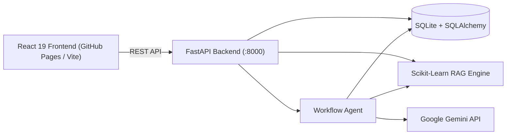

# DataBuddy AI 🚀

<p align="center">
  <a href="https://kratika2613.github.io/databuddy-ai/"></a>
  
  
  
  
  
</p>

DataBuddy AI is an intelligent data engineering learning and assessment platform. It pairs **Google Gemini** generative AI and an in-memory **Scikit-Learn RAG engine** with an autonomous **Remediation Agent** to help engineers master ETL, PySpark, Kafka, and SQL.

---

## ⚡ Core Features

- **AI Learning Assistant**: Multi-persona tutor (Beginner analogies, Interview trade-offs, and Senior Technical internals).
- **Interactive Quiz Studio**: Dynamic MCQs with immediate grading, distractor analysis, and answer review archives.
- **RAG Knowledge Center**: Document ingestion (`.pdf`, `.md`, `.txt`) with sliding-window chunking, TF-IDF vector retrieval, and grounded citations.
- **Autonomous Remediation Agent**: 4-stage pipeline that inspects weak telemetry, searches RAG notes, generates targeted practice questions, and formulates a study plan.
- **Performance Analytics**: Real-time Recharts progression metrics, accuracy trends, and automated weak-area alerts (<65%).

---

## 🏗️ Architecture



---

## 🚀 Quickstart

### 1. Clone & Setup Backend
```bash
git clone https://github.com/Kratika2613/databuddy-ai.git
cd databuddy-ai

python3 -m venv .venv
source .venv/bin/activate
pip install -r requirements.txt
```

### 2. Configure Environment (`.env`)
```bash
cp .env.example .env
```
Add your [Google Gemini API Key](https://aistudio.google.com/app/apikey) in `.env` (built-in offline fallbacks are used if omitted).

### 3. Build & Run
```bash
# Build React frontend
cd frontend && npm install && npm run build && cd ..

# Start unified FastAPI server
python server.py
```

- 🌐 **Web App**: [http://localhost:8000](http://localhost:8000)
- 📑 **Swagger API Docs**: [http://localhost:8000/docs](http://localhost:8000/docs)
- 🧪 **Run Tests**: `pytest tests/ -v`

---

## 🌐 GitHub Pages Deployment

The frontend automatically builds and deploys to **GitHub Pages** via GitHub Actions upon push to `main`.

1. Go to **Settings** → **Pages** in your repository.
2. Under **Build and deployment** → **Source**, select **GitHub Actions**.
3. Push to `main` — the workflow `.github/workflows/deploy.yml` deploys the site live!

---

## 🔌 API Endpoints

| Method | Endpoint | Description |
|---|---|---|
| `GET` | `/api/health` | System telemetry & database health |
| `POST` | `/api/chat` | AI conceptual learning assistant |
| `POST` | `/api/quiz/generate` | Generate 4-option MCQs |
| `POST` | `/api/quiz/submit` | Evaluate quiz response & log metrics |
| `POST` | `/api/knowledge/upload` | Upload & vectorize PDF/MD/TXT notes |
| `POST` | `/api/knowledge/query` | RAG semantic similarity query |
| `POST` | `/api/agent/run` | Execute autonomous diagnostic workflow |
| `GET` | `/api/analytics/dashboard` | Aggregated user performance metrics |

---

## 📂 Project Structure

```
databuddy-ai/
├── frontend/             # React 19 SPA (Vite + Tailwind CSS + Recharts)
├── services/             # AI (Gemini), RAG (TF-IDF), and Agent workflows
├── storage/              # SQLite database and SQLAlchemy ORM models
├── tests/                # Automated pytest suite
├── server.py             # FastAPI backend server
├── .github/workflows/    # Automated GitHub Pages CI/CD workflow
├── .gitattributes        # Configures Python as primary repository language
└── requirements.txt      # Python dependencies
```

---

## 🛡️ License
MIT License. Built for data engineering mastery.