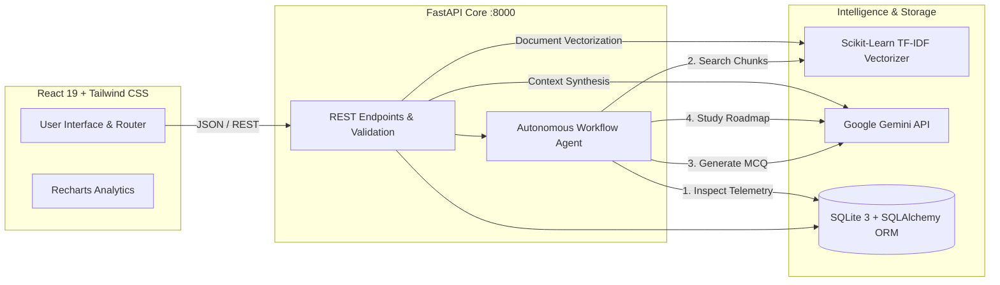

# DataBuddy AI — Intelligent Data Engineering Platform

<p align="center">
  
  
  
  
  
  
</p>

An intelligent, full-stack learning and assessment platform built for Data Engineers and Technical Interview candidates. Combines **Google Gemini** generative intelligence, an in-memory **Scikit-Learn RAG vector search engine**, an autonomous **Tool-Based Workflow Agent**, and **SQLite + SQLAlchemy** relational telemetry.

---

## ⚡ Highlights & Key Capabilities

| Module | Core Functionality | Underlying Tech Stack |
|---|---|---|
| **AI Learning Assistant** | Adapts explanations across **Beginner** (analogies), **Interview** (4–7 line crisp trade-offs), and **Senior Technical** (distributed internals & code snippets) modes with proactive follow-up recommendations. | Google Gemini (`google-genai`), SQLite chat memory |
| **Intelligent Quiz Studio** | Generates dynamic 4-option MCQs across core domains (ETL, PySpark, Delta Lake, Kafka, SQL) with instant grading, distractor analysis, and answer review archives. | Gemini structured JSON, SQLAlchemy ORM |
| **Knowledge Center & RAG** | Upload technical documentation (`.pdf`, `.md`, `.txt`). Chunks text using sliding windows, builds TF-IDF embeddings, and performs cosine similarity search with source citations. | PyPDF, Scikit-learn TF-IDF, Gemini context synthesis |
| **Learning Workflow Agent** | Autonomous 4-stage pipeline: queries database metrics for weak topics, retrieves grounding notes via RAG, synthesizes a targeted remediation MCQ, and generates a 3-step personalized roadmap. | Multi-tool Python agent orchestrator, SQLite logging |
| **Performance Dashboard** | Real-time database telemetry tracking queries, quiz attempts, and accuracy with Recharts progression trendlines and automated weak-topic alerts (<65% accuracy). | Recharts, SQLAlchemy aggregation queries |

---

## 🏗️ Architecture Flow



---

## 🚀 Quickstart Guide

### 1. Prerequisites
- **Python 3.10+**
- **Node.js 18+** & **npm**

### 2. Backend Setup
```bash
# Clone the repository
git clone https://github.com/Kratika2613/databuddy-ai.git
cd databuddy-ai

# Create and activate Python virtual environment
python3 -m venv .venv
source .venv/bin/activate

# Install backend dependencies
pip install -r requirements.txt
```

### 3. Configure Environment Variables
Create a `.env` file in the project root (reference template in `.env.example`):
```env
GEMINI_API_KEY=your_gemini_api_key_here
GEMINI_MODEL=gemini-3.5-flash-lite
DATABASE_URL=sqlite:///./databuddy.db
HOST=0.0.0.0
PORT=8000
```
> *(Get a free Gemini API key from [Google AI Studio](https://aistudio.google.com/app/apikey). If left unconfigured, intelligent built-in domain fallbacks allow full offline exploration).*

### 4. Build Frontend & Launch
```bash
# Build the React production bundle
cd frontend
npm install
npm run build
cd ..

# Start the unified FastAPI server
python server.py
```

- 🌐 **Web Application**: [http://localhost:8000](http://localhost:8000)
- 📑 **Interactive Swagger API Docs**: [http://localhost:8000/docs](http://localhost:8000/docs)
- 📊 **ReDoc Documentation**: [http://localhost:8000/redoc](http://localhost:8000/redoc)

---

## 🧪 Automated Testing

Run the end-to-end automated test suite covering FastAPI routes, SQLAlchemy models, RAG vector retrieval, and agent workflows:

```bash
pytest tests/ -v
```

---

## 🔌 API Reference

| Method | Endpoint | Description |
|---|---|---|
| `GET` | `/api/health` | Live system telemetry, database status, and configuration check |
| `POST` | `/api/chat` | AI conceptual learning assistant with mode selection |
| `GET` | `/api/chat/history` | Historical conversation turns retrieved from SQLite |
| `POST` | `/api/quiz/generate` | Generates 4-option multiple-choice assessment questions |
| `POST` | `/api/quiz/submit` | Evaluates answer correctness and updates database metrics |
| `GET` | `/api/quiz/reviews` | Completed quiz answer history and explanations |
| `POST` | `/api/knowledge/upload` | Ingests PDF/MD/TXT notes into vector chunk partitions |
| `POST` | `/api/knowledge/query` | TF-IDF similarity search and grounded LLM synthesis |
| `POST` | `/api/agent/run` | Executes the 4-step autonomous diagnostic and remediation agent |
| `GET` | `/api/analytics/dashboard` | Aggregated quiz telemetry, Recharts trendlines, and weak topics |

---

## 📂 Project Structure

```
databuddy-ai/
├── frontend/                  # React 19 Frontend
│   ├── src/
│   │   ├── components/        # Navigation, TopHeader
│   │   ├── pages/             # AssistantPage, QuizStudioPage, KnowledgePage, AgentPage, DashboardPage, PreferencesPage
│   │   ├── services/          # API Client Layer (Fetch)
│   │   ├── App.jsx            # React Router Architecture
│   │   └── index.css          # Tailwind CSS Directives & Ambient Tokens
│   ├── dist/                  # Optimized Production Build (Served by FastAPI)
│   └── package.json           # Frontend Dependencies
├── services/                  # Python Business Logic Layer
│   ├── ai_service.py          # Google Gemini (google-genai) Client & Prompts
│   ├── rag_service.py         # PyPDF Text Extraction, TF-IDF Vectorizer & Cosine Similarity
│   └── agent_service.py       # Controlled Tool-Based Learning Workflow Agent
├── storage/                   # Relational Persistence
│   ├── models.py              # SQLAlchemy ORM Models
│   └── database.py            # SQLite Engine, SessionMaker & Repository
├── tests/                     # Automated Test Suite
│   └── test_backend.py        # Integration & Unit Tests (100% Pass)
├── server.py                  # Enterprise FastAPI Application & Asset Server
├── requirements.txt           # Python Package Requirements
├── .env.example               # Environment Configuration Template
├── .gitattributes             # Configures Language Tracking for GitHub
├── .gitignore                 # Excludes .env, *.db, and virtualenvs
└── README.md                  # Documentation
```

---

## 🛡️ License
Distributed under the MIT License. Built for Data Engineering mastery.