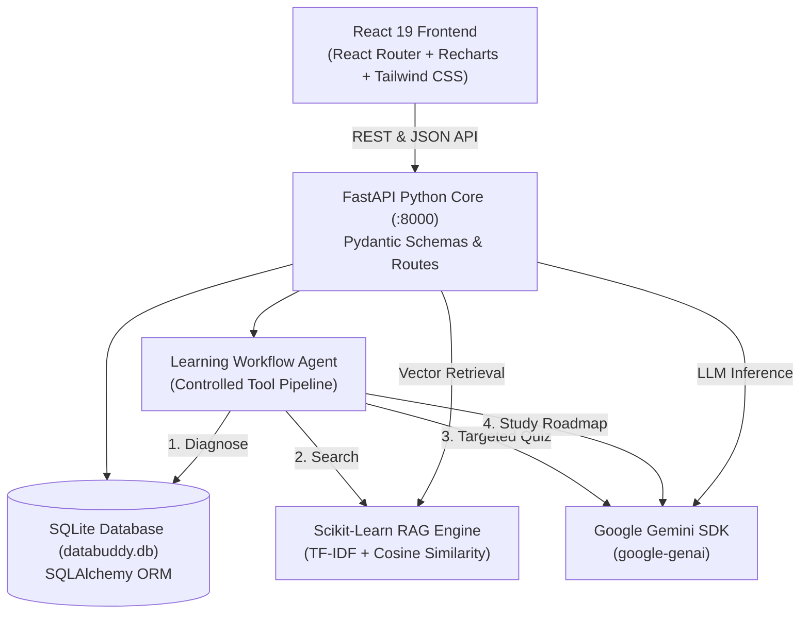

# 🤖 DataBuddy AI — Intelligent Data Engineering Learning Platform

[](https://www.python.org/)
[](https://fastapi.tiangolo.com/)
[](https://www.sqlalchemy.org/)
[](https://react.dev/)
[](https://reactrouter.com/)
[](https://tailwindcss.com/)
[](https://www.sqlite.org/)
[](https://scikit-learn.org/)
[](https://aistudio.google.com/)

> **DataBuddy AI** is a production-grade, full-stack Data Engineering Learning & Assessment Platform. Built with Python (FastAPI, SQLAlchemy, SQLite, Scikit-learn, Google Gemini) and React (Vite, React Router, Recharts, Tailwind CSS), it provides multi-lens conceptual instruction, dynamic multiple-choice assessment, PDF/MD RAG retrieval, and an autonomous tool-based workflow agent.

---

## 🌟 Core Features

1. **AI Learning Assistant**
   - Multi-mode explanations across **Beginner**, **Interview**, and **Senior Technical** lenses.
   - Interactive follow-up questions generated by Gemini for proactive mastery.
   - Persistent conversation memory backed by SQLite.

2. **Intelligent Quiz Studio**
   - Dynamic 4-option multiple-choice question generator across technical domains (ETL, PySpark, Delta Lake, Kafka, SQL, Data Modeling).
   - Configurable difficulty levels (*Easy*, *Medium*, *Hard*).
   - Instant grading, distractor analysis, score streaks, and an answer review archive.

3. **Knowledge Center & RAG Notes Lab**
   - Drag-and-drop ingestion of `.pdf`, `.md`, and `.txt` technical documentation.
   - Sliding-window text chunking and Scikit-Learn TF-IDF vector embeddings.
   - Grounded context synthesis with source citations (`[Source 1]`, `[Source 2]`) and cosine similarity ranking.

4. **Learning Intelligence & Performance Dashboard**
   - Live SQLite database telemetry tracking total questions, quiz evaluations, and accuracy metrics.
   - **Recharts** cumulative accuracy progression line charts and topic breakdown bar charts.
   - Automated diagnostic weak-topic detection (<65% accuracy) with personalized revision suggestions.

5. **Learning Workflow Agent**
   - Autonomous, tool-based agent that orchestrates:
     - `diagnose_state()`: Evaluates learning history and identifies weak topics in SQLite.
     - `search_knowledge()`: Retrieves grounding documentation passages via RAG.
     - `generate_targeted_quiz()`: Generates an assessment targeted at the weakest topic.
     - `generate_study_roadmap()`: Synthesizes a prioritized 3-step action plan tailored to the target role.

---

## 🏗️ Technical Architecture



---

## 💻 Local Setup & Execution

### 1. Prerequisites
- **Python 3.10+**
- **Node.js 18+** & **npm**

### 2. Clone & Environment Setup
```bash
# Clone the repository
git clone https://github.com/Kratika2613/databuddy-ai.git
cd databuddy-ai

# Create and activate Python virtual environment
python3 -m venv .venv
source .venv/bin/activate

# Install backend dependencies
pip install -r requirements.txt
```

### 3. Configure Gemini API Key
Create a `.env` file in the project root based on `.env.example`:
```env
GEMINI_API_KEY=your_gemini_api_key_here
GEMINI_MODEL=gemini-3.5-flash-lite
DATABASE_URL=sqlite:///./databuddy.db
HOST=0.0.0.0
PORT=8000
```
> *(Get a free API key at [Google AI Studio](https://aistudio.google.com/app/apikey). If left unconfigured, intelligent domain fallbacks allow full offline exploration).*

### 4. Build Frontend & Run Server
```bash
# Install frontend packages and build bundle
cd frontend
npm install
npm run build
cd ..

# Launch the unified FastAPI platform
python server.py
```

### 5. Access the Platform
- 🌐 **Web Platform**: [http://localhost:8000](http://localhost:8000)
- 📑 **FastAPI Swagger Docs**: [http://localhost:8000/docs](http://localhost:8000/docs)
- 📊 **Alternative API Docs**: [http://localhost:8000/redoc](http://localhost:8000/redoc)

---

## 🧪 Automated Testing
Run the complete automated test suite (FastAPI endpoints, SQLAlchemy models, RAG vector search, and Agent workflow):
```bash
pytest tests/ -v
```

---

## 📁 Repository Structure
```
databuddy-ai/
├── frontend/                  # React 19 + Tailwind CSS Frontend
│   ├── src/
│   │   ├── components/        # Navigation, TopHeader
│   │   ├── pages/             # AssistantPage, QuizStudioPage, KnowledgePage, AgentPage, DashboardPage, PreferencesPage
│   │   ├── services/          # API Client Layer (Fetch)
│   │   ├── App.jsx            # React Router Architecture
│   │   └── index.css          # Tailwind CSS Directives
│   ├── dist/                  # Optimized Production Build (Mounted by FastAPI)
│   └── package.json           # Frontend Dependencies (Recharts, React Router, Lucide)
├── services/                  # Python Domain Logic Services
│   ├── ai_service.py          # Google Gemini (google-genai) Client & Prompts
│   ├── rag_service.py         # PyPDF Text Extraction, TF-IDF Vectorizer & Cosine Similarity
│   └── agent_service.py       # Controlled Tool-Based Learning Workflow Agent
├── storage/                   # Relational Persistence Layer
│   ├── models.py              # SQLAlchemy ORM Models (Conversations, Quizzes, Knowledge, Logs)
│   └── database.py            # SQLite Engine, SessionMaker & Repository Queries
├── tests/                     # Automated Test Suite
│   └── test_backend.py        # Integration & Unit Tests
├── server.py                  # Enterprise FastAPI Application & Static File Server
├── requirements.txt           # Python Package Requirements
├── .env.example               # Environment Configuration Template
├── .gitattributes             # Configures Python as Primary Language on GitHub
├── .gitignore                 # Excludes .env, *.db, and virtualenvs
└── README.md                  # System Documentation
```

---

## 🛡️ License
Distributed under the MIT License. Built for Data Engineering mastery.